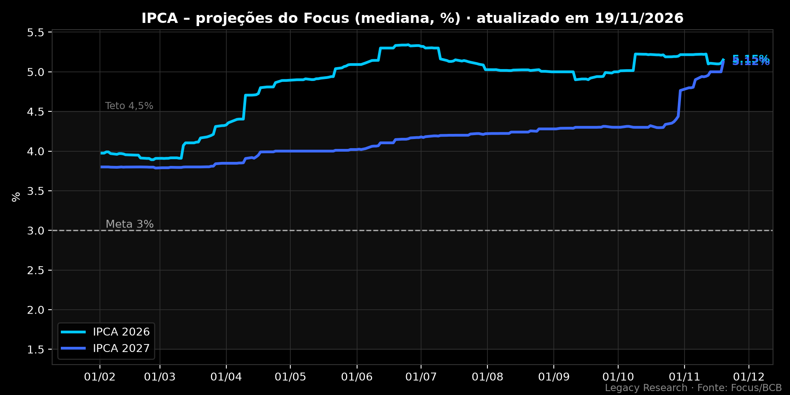

# focus-tracker

Acompanhamento automático das projeções do mercado para a inflação brasileira, a partir do Boletim Focus do Banco Central.

Toda segunda-feira, um robô no GitHub Actions busca os dados na API do Banco Central com Python, gera o gráfico abaixo e salva o histórico em CSV, sem intervenção manual.

## Como funciona
- `focus_ipca.py`: busca os dados na API do BCB, organiza com pandas e gera o gráfico com matplotlib
- `.github/workflows/atualizar-focus.yml`: agenda que roda o script toda segunda às 12h
- `dados/focus_ipca.csv`: histórico das projeções

Fonte: Banco Central do Brasil (Boletim Focus).

## SQL
O `focus_sql.py` guarda o histórico do Focus num banco SQLite e responde três perguntas com SQL:
a última projeção de cada indicador, a maior e a menor projeção de IPCA e a média por indicador e ano.
